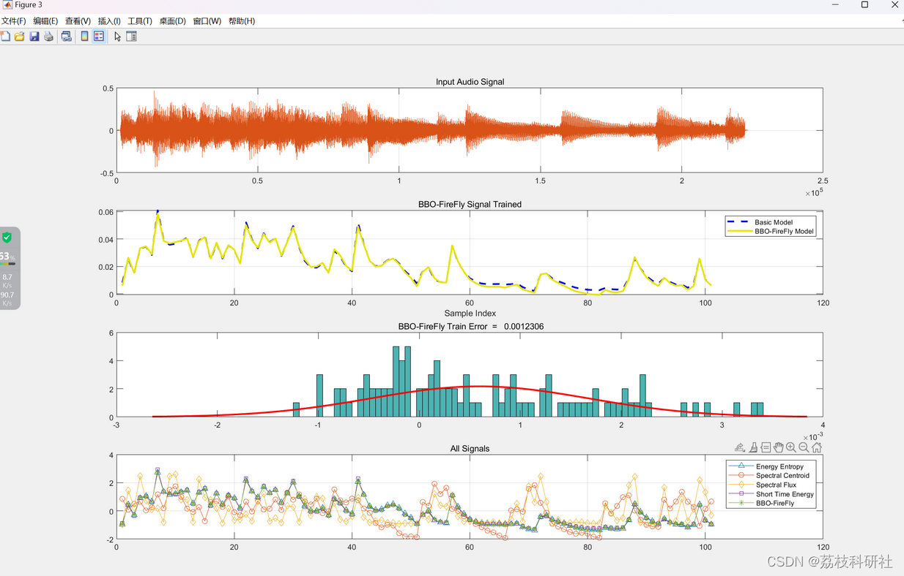
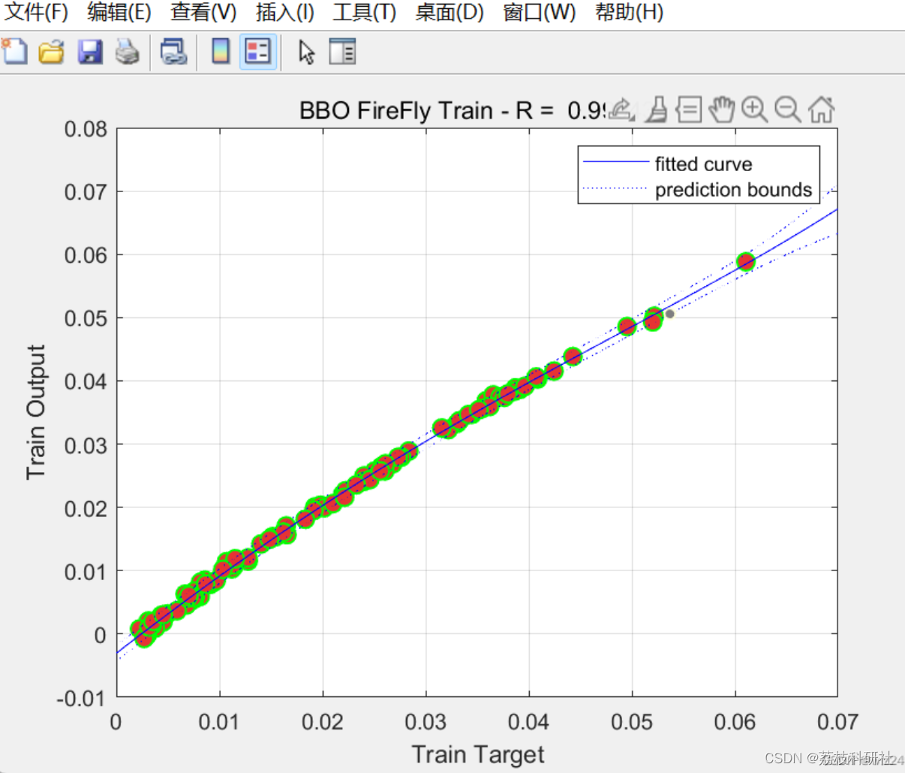
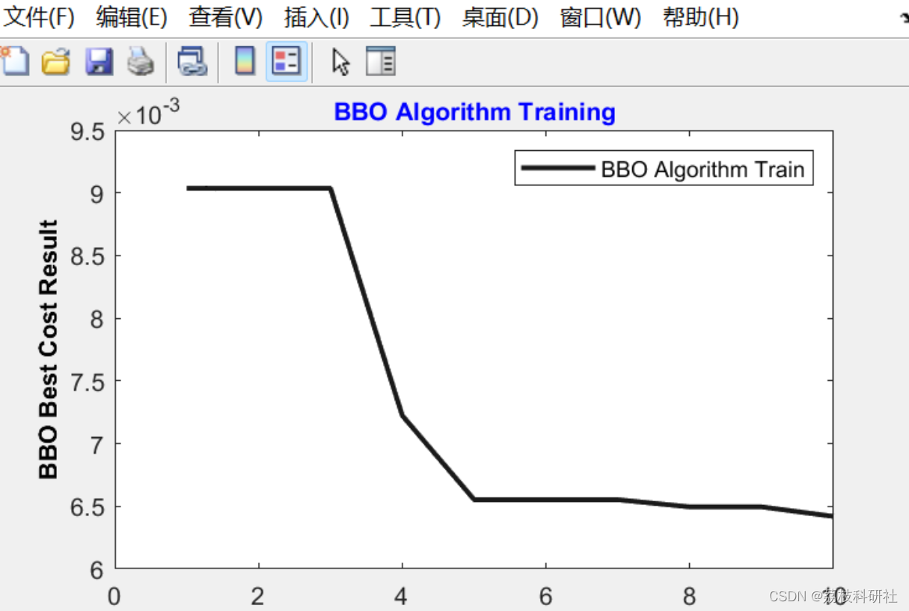
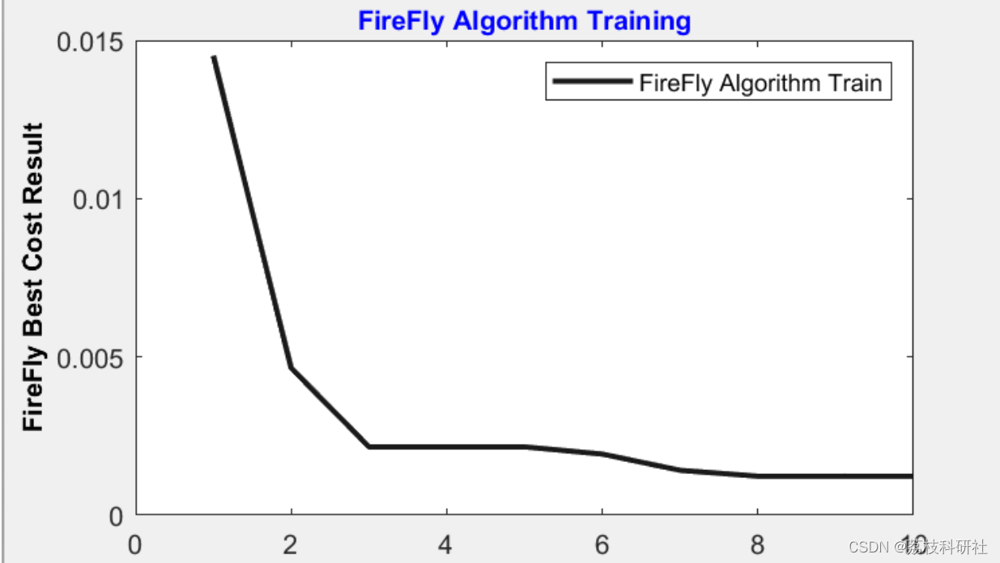

# Optimization of the Firefly Algorithm Based on Mixed Biogeography Research (Matlab Code Implementation)

📚2 Running Results Editing
Editing
Editing
Part of the code:
%% Making Things Ready
clc; 
clear; 
warning('off'); 
%% Music Signal Loading
[signal,fs] = audioread('Setar.wav'); 
win = 0.050; 
step = 0.050; 
fs=44100; 
%% Time Domain Features
EnergyEntropy = Energy_Entropy_Block(signal, win*fs, step*fs, 10)'; 
ShortTimeEnergy = ShortTimeEnergy(signal, win*fs, step*fs); 
%% Frequency Domain Features
SpectralCentroid = SpectralCentroid(signal, win*fs, step*fs, fs); 
SpectralFlux = SpectralFlux(signal,win*fs, step*fs, fs); 
%% Making Inputs and Targets
Inputs=[EnergyEntropy SpectralCentroid SpectralFlux]'; 
Targets=ShortTimeEnergy'; 
data.Inputs=Inputs; 
data.Targets=Targets;
data=JustLoad(data);  
%% Generate Basic Fuzzy Model  
ClusNum=3; % FCM Cluster Number  
fis=GenerateFuzzy(data,ClusNum);  
%% BBO-FireFly Algorithm Learning  
BBOFuzzy=BBOFCN(fis,data);  
BBOFireFlyFuzzy=FireFlyFCN(BBOFuzzy,data);  
%% BBO-FireFly Results  
% BBO-FireFly  
TrTar=data.TrainTargets;  
TrainOutputs=evalfis(data.TrainInputs,BBOFireFlyFuzzy);  
% Basic and BBO-FireFly Models  
BasicFeature=data.TrainTargets;  
BBOFireFly=TrainOutputs;  
% BBO-FireFly Train Errors Calculations  
Errors=data.TrainTargets-TrainOutputs;  
MSE=mean(Errors.^2);  
RMSE=sqrt(MSE);  
error_mean=mean(Errors);  
error_std=std(Errors);  
%% BBO-FireFly Algorithm Plots  
figure('units','normalized','outerposition',[0 0 1 1])  
subplot(4,1,1);  
plot(signal);  
title('Input Audio Signal');  
grid on;  
% Plot Train Result  
subplot(4,1,2);  
plot(data.TrainTargets,'--',...  
'LineWidth',2,...  
'MarkerSize',3,...  
'MarkerEdgeColor','b',...  
'Color',[0.0,0.0,0.9]);  
hold on;  
plot(TrainOutputs,'-',...  
'LineWidth',2,...  
'MarkerSize',3,...  
'MarkerEdgeColor','m',...  
'Color',[0.9,0.9,0.0]);  
legend('Basic Model','BBO-FireFly Model');  
title('BBO-FireFly Signal Trained');  
xlabel('Sample Index');  
grid on;  
% Plot Distribution Fit Histogram  
subplot(4,1,3);  
h=histfit(Errors, 80);  
h(1).FaceColor = [.3 .7 0.7];  
title([' BBO-FireFly Train Error = ' num2str(RMSE)]);  
% Plot Signals  
subplot(4,1,4);  
plot(normalize(EnergyEntropy),'-^');hold on;  
plot(normalize(SpectralCentroid),'-o');hold on;  
plot(normalize(SpectralFlux),'-d');hold on;  
plot(normalize(ShortTimeEnergy),'-s');hold on;  
plot(normalize(BBOFireFly),'-*');  
hold off;  
legend('Energy Entropy','Spectral Centroid', 'Spectral Flux', 'Short Time Energy', 'BBO-FireFly');  
title('All Signals');  
grid on;  
%% Regression Line  
[population2,gof] = fit(BasicFeature,BBOFireFly,'poly4');  
figure;  
plot(BasicFeature,BBOFireFly,'o',...  
'LineWidth',1,...  
'MarkerSize',8,...  
'MarkerEdgeColor','g',...  
'MarkerFaceColor',[0.9,0.2,0.2]);  
title(['BBO FireFly Train - R = ' num2str(1-gof.rmse)]);  
xlabel('Train Target');  
ylabel('Train Output');  
hold on  
plot(population2,'b-','predobs');  
xlabel('Train Target');  
ylabel('Train Output');  
grid on;  
hold off;  
🌈3 Matlab code implementation
🎉4 References
​  

## Images

<!-- PAYMENT_BLOCK -->

## Get this dataset

- Payment link (Stripe): [Buy now](https://buy.stripe.com/3cs8yP7sY87d0vu9AB)
- Payment QR code: 

<!-- /PAYMENT_BLOCK -->
